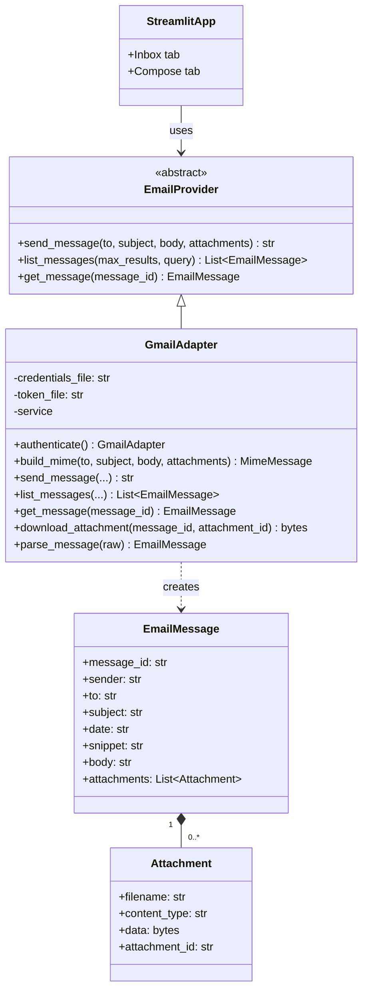

Submitted by: UMANG GOSWAMI | GitHub: @goswamiumang108 | Email: go.umang108@gmail.com
Ticket: SCRUM-17

# QuMail - Class Diagram v1 (Day 3, Level 1 baseline)

## Source of design
- From project documents: Gmail API + OAuth 2.0, Streamlit UI, `../../src/email/gmail_adapter.py` path, adapter functions `send_message()`, `list_messages()`, `get_message()`, `parse_message()`, provider-replaceable design, Python `email` package for MIME.
- My assumptions: the `EmailProvider` abstract class name, the `EmailMessage`/`Attachment` dataclass fields, scopes `gmail.send` + `gmail.readonly`, and fetching attachments lazily via `download_attachment`.

## Not in v1 (later tickets)
Encryption module, Key Manager client, QuMail envelope, SQLite. They plug in later without changing `EmailProvider`.
