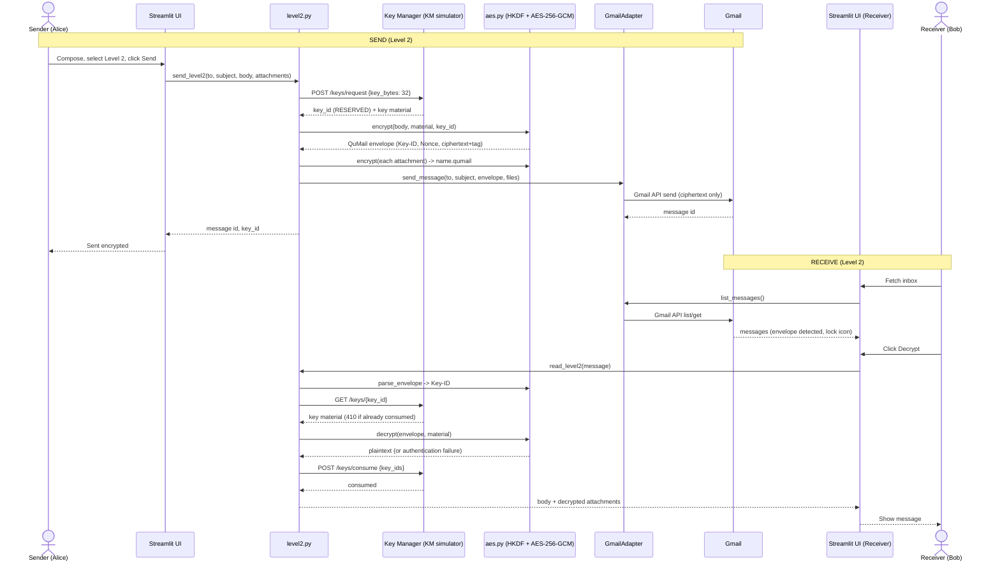

Submitted by: UMANG GOSWAMI | GitHub: @goswamiumang108 | Email: go.umang108@gmail.com
Ticket: SCRUM-23

# QuMail - Sequence Diagram: Level 2 (Quantum-aided AES) send and receive

## Failure paths (fail closed)
- KM down or key bank empty at send: nothing is sent, error shown.
- Wrong key, modified ciphertext or swapped Key-ID at receive: GCM authentication fails, key is not consumed.
- Key already consumed: KM returns 410, message cannot be decrypted again.

## Source of design
- From project documents: Level 2 = QKD key seeds AES (HKDF-SHA256 -> AES-256-GCM), only Key-ID in the email, QUMAIL-V1 envelope, KM endpoints (/keys/request, /keys/{id}, /keys/consume), RESERVED -> CONSUMED states, fail closed.
- My assumptions: receiver (not sender) consumes the key after a successful decrypt, one 1 KB key block per message, attachments saved as `<name>.qumail`.
